# PathSnap: Distributed Map-Matching and Route Reconstruction

**Technical Report** · PES University, Department of Computer Science and Engineering (RR Campus) · UE24CS352A: Machine Learning · PathSnap Hackathon

| SRN | Name |
|---|---|
| PES1UG24AM244 | Samarth Rajesh Rao |
| PES1UG24AM245 | Samhitha Kanth |
| PES1UG24AM243 | Samarth Ambedkar |
| PES1UG24AM246 | Sampreeth Jaladi |

Repository: https://github.com/Samhithakanth/ML_HACKATHON

## Abstract

GPS fixes from vehicles are noisy, so a track must be matched to the road network to recover the route actually driven. PathSnap generates candidate road segments for every GPS point (all arcs within 100 m, at most 30),
scores each candidate with a gradient-boosted classifier trained on 31 geometric, heading, kinematic, topological and temporal-context features, and decodes a connected route with an HMM and Viterbi algorithm over the directed road graph.
Six models from different families were compared by cross-validation grouped by trip; LightGBM was tuned with Bayesian optimisation (Optuna TPE, 30 trials). The decoder was tuned on out-of-fold training predictions only.
On the held-out evaluator_test partition (10 trips, 19,674 points) the frozen system assigns the correct reference road segment to **95.8 %** of observations (classifier alone: 81.5 %) with route continuity 0.978.
The system is served by a FastAPI backend and an evaluator UI on two laptops; reference labels stay server-side.

**Data partitions.** `train`: 80 trips (78 clean + 2 label-suspect trips reported separately) for fitting, cross-validation, tuning and decoder tuning. `student_test`: 10 trips for development-stage comparison. `evaluator_test`: 10 trips, final evaluation only (Appendix A).

[TOC]

---


## 2. Problem Context, Dataset and Exploratory Data Analysis

### 2.1 Problem and approach in brief
A vehicle's GPS track is noisy (parallel-street drift, jumps, dropouts), so the road segments actually driven must be recovered by matching the track to a road network. PathSnap does this in three stages:
(i) **candidate generation**: for every GPS point, all arcs of the road network within 100 m (at most the 30 nearest); (ii) a **classifier** that scores each (point, candidate) pair; (iii) **HMM / Viterbi decoding** over the directed road graph so that the chosen arcs form a connected route.
A FastAPI backend (Laptop 1) runs the pipeline and an evaluator UI (Laptop 2) displays the result. The data come as 80 training trips, 10 student-test trips and 10 evaluator trips (Appendix A); the analysis below uses the training and student-test partitions only.

### 2.2 Dataset Understanding and Exploratory Data Analysis

**Partitions.** `train` = 80 trips (208,417 GPS points). `student_test` = 10 trips (19,160 points). The hidden evaluator partition was never
read. All thresholds and design choices in this section (candidate radius, cap, label-quality rule) were derived from **train only**;
`student_test` was used only to report the same statistics. Source of every number: `results/eda/` (scripts in `src/data/`, `src/viz/`; notebook `notebooks/01_eda.ipynb`).

#### Dataset structure

Each trip is a folder of four files: `.track` (longitude, latitude, timestamp: noisy GPS), `.nodes` (road-network junctions, row index = node id),
`.arcs` (directed road segments `from_node -> to_node`, row index = arc id) and `.route` (ordered arc ids the vehicle drove: the reference route).
A GPS row does not correspond to a network row, and `.route` contains **no per-point labels**.

| | train (80 trips) | student_test (10 trips) |
|---|---|---|
| GPS points | 208,417 (361 to 19,313 per trip) | 19,160 (262 to 3,958 per trip) |
| nodes per trip, median (range) | 9,608 (299 to 155,003) | 6,596 (1,770 to 26,635) |
| arcs per trip, median | 19,526 | 13,145 |
| reference-route arcs per trip, median | 280 | 250 |

Two facts shaped the whole design. (1) **Every trip has its own road network** (ids are local to the trip). (2) **Trips are located all over the
world** (one city each), so no single projected coordinate system is valid.
Source: `results/eda/trip_inventory.csv`.

#### 1. How did you preprocess the data?

1. **Coordinates to metres.** Longitude/latitude are angles, so Euclidean distance in degrees is wrong (a degree of longitude shrinks with latitude).
   My first choice, UTM zone 32N, produced NaN for trip 57 (located in Ecuador), which exposed that trips are worldwide. Each trip is therefore projected into
   its own **local azimuthal-equidistant system centred on its GPS centroid** (metres, `src/data/p1_loader.py`). At the largest trip extent (about 127 km) the scale error is of the
   order of 10^-5, so distances in metres are reliable.
2. **Quality checks** on all 90 trips (missing values, duplicates, coordinate order, timestamp order, plausibility, network structure); see the next subsection.
3. **Reference labels.** `.route` lists arcs only, so each GPS point was assigned a reference arc by a **monotone dynamic-programming alignment** to the route
   (`src/data/p1_labels.py`): minimise the total point-to-arc distance subject to the route position never decreasing (a vehicle cannot move backwards along its route).
   Nearest-arc-in-the-whole-network was rejected because parallel streets would be mislabelled.
4. **Candidate generation.** For every GPS point all arcs within **R = 100 m** are kept, capped at the **K = 30** nearest (`src/data/p1_candidates.py`, spatial index over arc
   geometries). This turns map matching into scoring a short candidate list per point.
5. **Output tables** `{train,student_test}_{points,candidates}.parquet` (schemas in `docs/P1_DATA_NOTES.md`), regenerated by `python -m src.data.build_dataset`.

**Choice of R and K (train only; `results/eda/plots/05_candidate_miss_rate.png`).** The candidate miss rate is the share of points whose reference arc is not among the candidates; it is an upper bound on any classifier.
On the 78 clean train trips: R = 20 m: 4.5 %; 50 m: 1.4 %; **100 m: 0.60 %**; 150 m: 0.42 %. Beyond 100 m the gain is small while the candidate count roughly doubles
(about 23 candidates/point at 100 m vs 43 at 150 m). A cap of K = 30 keeps nearly all of the benefit. This was read off the curve's elbow, not from a formal criterion.
Final miss rate: **0.65 % (train, clean trips), 0.09 % (student_test)**; including the two flagged trips the train miss rate is 10.2 %.

#### Missing-value and data-quality analysis

Source: `results/eda/trip_inventory.csv`, `label_audit.csv`; plots in `results/eda/plots/`.

| Check | train (80) | student_test (10) |
|---|---|---|
| NaN values in `.track` | 0 | 0 |
| duplicate GPS rows | 0 | 0 |
| non-increasing timestamps | 0 trips | 0 trips |
| longitude/latitude swapped | none | none |
| GPS fixes outside the network bounding box | 0 | 0 |
| isolated nodes | 0 | 0 |
| steps exactly 1 s apart (pooled) | 96.5 % | 98.6 % |
| trips with a time gap > 60 s | 22 (largest 153,064 s, trip 90) | 1 (210 s) |
| trips with a position jump > 100 m between fixes | 23 (up to 888 m) | 0 |
| trips with a disconnected road network (> 1 component) | 79 | 10 |
| trips containing zero-length arcs | 29 | 3 |
| trips whose reference route has a break (consecutive arcs not sharing a node) | 10 | 1 |

"Missing" observations in this dataset are therefore **time gaps** (no GPS fix for a while), not empty cells. Their consequence: the HMM must restart rather than link points across a long gap.
Disconnected networks mean a transition between two candidate arcs can be impossible, which the decoder must handle. Zero-length arcs require guarded distance/heading computations.
Two further "missing" cases arise from candidate generation: 0.68 % of train points have **no candidate within 100 m** (almost all in the two flagged trips; 0 % in student_test), and
25.8 % (train) / 41.6 % (student_test) of points hit the K = 30 cap, i.e. are in dense networks where more than 30 arcs lie within 100 m.

**Label quality and the two flagged trips (train).** Across 88 trips the median distance from a GPS point to its aligned reference arc is about 4.6 m (train, median over trips) and 4.7 m (student_test),
99th percentile about 21 m and 25 m (`plots/04_label_distance.png`). We also checked the alignment on six hard trips (long gaps, loops, the longest trip): no backward jumps in route position and no
forward jumps of more than 20 arcs except at time gaps (`plots/07_label_alignment_check.png`). **Train trips 33 and 54 are an exception**: the GPS lies on a road but about 130 m from
the reference route for long stretches (offset about 0 m at the start of the trip, about 130 m mid-trip), so 54 % and 87 % of their points have no true arc within 100 m. In trip 33 the map shows
a stationary cluster of GPS fixes with the reference route about 130 m away (Figure below, right). We flag them (`trip_label_suspect`) and exclude them from fitting and selection, reporting them separately.
The reference route is therefore treated as reference information, not verified ground truth; all student_test trips are clean.

#### 2. What patterns did you observe, and which features did you extract and why?

**Patterns** (train unless stated):
- Trips are very uneven in length (361 to 19,313 points; the longest trip is 9 % of all train points), so a few long trips could dominate training; cross-validation is grouped by trip and training rows are sampled per trip (Section 3).
- Typical step between fixes is about 13 m (median over trips, train) at 1 Hz, i.e. about 48 km/h; arcs have a median length of about 25 m (train), so consecutive fixes often skip several arcs and a vehicle's arc changes every 1 to 3 seconds.
- About 82 % of arcs have a reverse twin with identical geometry (two-way streets). Distance to the point cannot tell the two directions apart; **heading** can.
- Dense urban areas give many close candidates (26 % of train points hit the cap), so the **gap to the next-nearest candidate** is informative.
- Network sizes vary by two orders of magnitude (299 to 155,003 nodes), so no per-network structure can be shared between trips.

**Features.** Candidate-stage columns (this section): perpendicular distance `dist_m`, projection position along the arc `frac`, distance rank `rank`, time since previous fix `dt_prev`, candidate count.
The full engineered model input (31 features: geometry, relative-distance, heading, kinematics, topology, temporal context) was built by Person 2 in `src/features/build.py` and is justified feature by feature in Section 3.
The choices follow directly from the patterns above: distance for "closest road", heading to separate the two directions of a street, relative-distance features because of the cap, kinematics because heading is unreliable when almost stopped, and
topology/context features because the true arc is usually connected to the arc chosen at the neighbouring fixes.

#### Visualisations

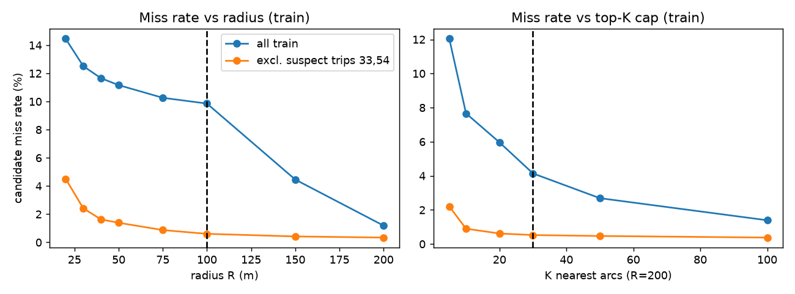
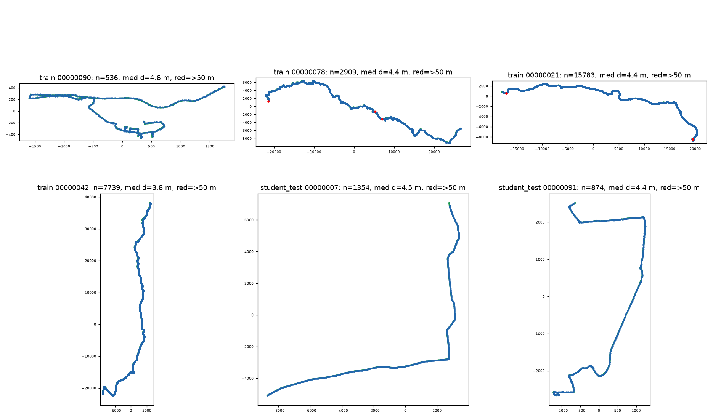
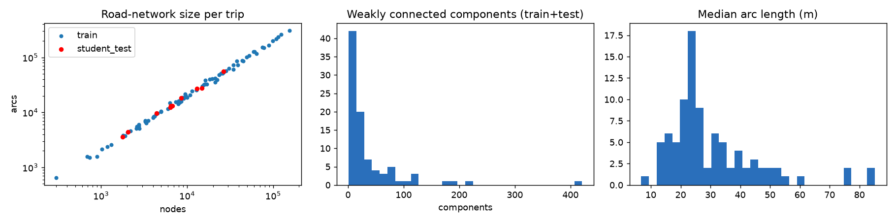
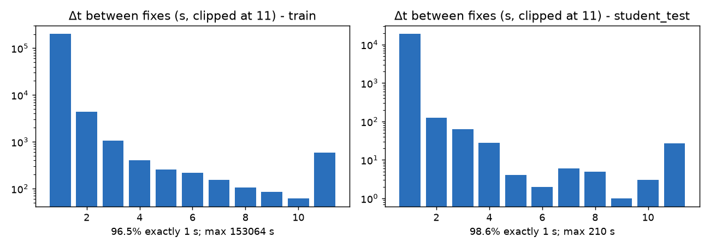


Partition for each figure is stated in its title or here.

| Figure | File | Partition |
|---|---|---|
| GPS points per trip | `results/eda/plots/01_points_per_trip.png` | train and student_test |
| Time step between fixes | `results/eda/plots/02_dt_distribution.png` | train and student_test |
| Road-network size and connectivity (nodes vs arcs, components, arc length) | `results/eda/plots/03_network_stats.png` | train and student_test |
| GPS-to-reference-arc distance | `results/eda/plots/04_label_distance.png` | train and student_test |
| Candidate miss rate vs radius and cap | `results/eda/plots/05_candidate_miss_rate.png` | train only |
| Candidates per point | `results/eda/plots/06_candidates_per_point.png` | train |
| Label-alignment check (GPS over reference route, six hard trips) | `results/eda/plots/07_label_alignment_check.png` | train (4 trips), student_test (2 trips) |

**GPS trajectory plots**: `07_label_alignment_check.png` (blue = GPS, green = reference route, red = points more than 50 m from their reference arc).
**Road-network visualisation**: `03_network_stats.png` and the Folium maps below (grey network layer).

#### Folium maps (interactive HTML committed in `results/maps/`; code `src/viz/p1_folium_map.py`)

| Map | Description |
|---|---|
| `results/maps/eda_train_00000001.html` (screenshot `results/maps/screenshots/eda_train_00000001.png`) | train trip 00000001, 15 consecutive fixes on a motorway interchange (Darmstadt area): GPS fixes (blue), road network within 150 m of the GPS (grey), reference route (green), and the candidate arcs of one point (orange), with legend and layer control |
| `results/maps/eda_train_00000033_drift.html` (screenshot `results/maps/screenshots/eda_train_00000033_drift.png`) | train trip 00000033, 60 fixes: a stationary cluster of GPS fixes (blue) about 130 m from the reference route (green): the reference-route limitation described above |

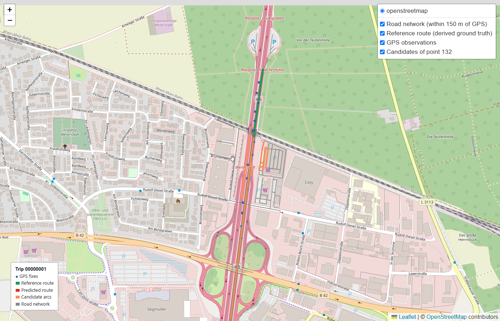
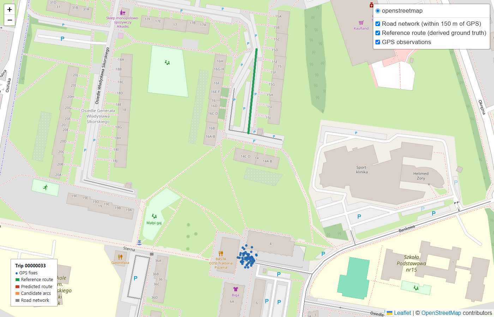

#### Assumptions and limitations

1. Per-point reference labels are derived from the reference route by an alignment; they are not independently verified ground truth.
2. The alignment minimises distance under a forward-only constraint but does not enforce arc connectivity.
3. The 100 m radius and K = 30 were chosen at the elbow of the train miss-rate curve; the 10 % rule that flags a trip as label-suspect is a judgement call (the two flagged trips are far from all others, so any reasonable threshold selects the same two).
4. K = 30 truncates the candidate list in dense areas (25.8 % of train, 41.6 % of student_test points hit the cap).
5. Distances rely on a local projection per trip, valid at trip scale.

---

## 3. Model Experimentation and Comparison

### 3.1 Overall model comparison

Source: `results/model_comparison.csv` (+ `results/model_route_metrics.csv` for continuity), table `results/model_comparison_table.csv`.
CV = 5-fold GroupKFold on clean train (mean ± std over folds). Test = student-test (10 trips, 19,160 points). Inference time is
measured on the full student-test candidate set (366,311 rows) on one laptop (22 logical cores).

| Model | Algorithm Family | Key Configuration | CV Macro F1-score | Top-1 Accuracy | Route continuity | Student-Test Macro F1-score | Log Loss | Inference Time |
|---|---|---|---|---|---|---|---|---|
| Logistic Regression | Linear | StandardScaler + L2 logistic regression, C=1.0, lbfgs | 0.9045 ± 0.0171 | 0.841 | 0.930 | 0.907 | 0.046 | 0.30 ms / 1k candidates |
| Gaussian Naive Bayes | Probabilistic generative | StandardScaler + Gaussian naive Bayes, var_smoothing=1e-9 | 0.7441 ± 0.0071 | 0.772 | 0.919 | 0.738 | 0.797 | 0.36 ms / 1k candidates |
| K-Nearest Neighbours | Instance-based | StandardScaler + KNN, k=25, distance-weighted, 120k-row training subsample | 0.8901 ± 0.0193 | 0.826 | 0.918 | 0.896 | 0.058 | 57.71 ms / 1k candidates |
| Random Forest | Bagging ensemble | 300 trees, min_samples_leaf=5, max_features=sqrt | N/A (1) | 0.867 | 0.939 | N/A (1) | N/A (1) | N/A (1) |
| LightGBM (untuned) | Gradient boosting | LightGBM defaults: 100 trees, lr=0.1, num_leaves=31 | 0.9245 ± 0.0177 | 0.866 | 0.922 | 0.926 | 0.043 | 0.34 ms / 1k candidates |
| MLP | Neural network | StandardScaler + MLP (128, 64), ReLU, Adam, early stopping, <=30 epochs, 300k-row subsample | 0.9191 ± 0.0162 | 0.866 | 0.944 | 0.922 | 0.038 | 0.78 ms / 1k candidates |
| LightGBM (Bayesian-tuned) | Gradient boosting | Optuna TPE best (see Section 4) | 0.9298 | 0.882 | 0.946 | 0.933 | 0.032 | 51.41 ms / 1k candidates |

**Table 3.1b. The same models followed by HMM / Viterbi decoding (student-test).**

| Model | Top-1 (classifier only) | Top-1 (+ HMM) | Route continuity (classifier only) | Route continuity (+ HMM) |
|---|---|---|---|---|
| Logistic Regression | 0.841 | 0.922 | 0.930 | 0.984 |
| Gaussian Naive Bayes | 0.772 | 0.916 | 0.919 | 0.983 |
| K-Nearest Neighbours | 0.826 | 0.918 | 0.918 | 0.983 |
| Random Forest | 0.867 | 0.952 | 0.939 | 0.983 |
| LightGBM (untuned) | 0.866 | 0.958 | 0.922 | 0.983 |
| MLP | 0.866 | 0.935 | 0.944 | 0.983 |
| LightGBM (Bayesian-tuned) | 0.882 | 0.963 | 0.946 | 0.984 |

Top-1 Accuracy = observation-level top-1 on the 10 student-test trips (19,160 points); Route continuity = share of consecutive predicted arcs that are the same or directly connected; CV = 5-fold GroupKFold by trip on the 78 clean train trips (mean ± std over folds). All figures are measured; none is estimated.

(1) N/A: the cross-validation, macro-F1, log-loss and timing rows of the Random Forest are missing from the committed `results/model_comparison.csv` (the file was rewritten by a later partial run). Only its route metrics survive (`results/model_route_metrics.csv`). They are regenerated with `python -m src.models.train_compare random_forest`; no unverified figure is quoted here.

### 3.2 Compulsory Questions for Every Model

For each model the questions of Deliverables 3.2 are answered under the labels **A** (model understanding, Q1-2), **B** (training and configuration, Q5-6) and **C** (experimental results, Q7-9).

All numbers are student-test unless marked CV. "Train-fit top-1" is measured on 40 sampled training points per
training trip of each fold (`cv_train_top1_mean`); comparing it with CV top-1 is our over/underfitting evidence.
Candidate-level positives are 6.2 % of rows, so recall/precision refer to the positive class (the true arc).

#### 3.2.1 Logistic Regression (linear)
* **A1. Why was this algorithm considered suitable?** A calibrated linear baseline: most of the signal is monotone in a few features (closer, better aligned,
  present in the neighbouring points), so a linear log-odds model is a reasonable first fit. Its probabilities are directly usable as HMM emissions.
* **A2. Major strengths and limitations.** Fast (4 s fit, 0.30 ms per 1k candidates), stable across folds, interpretable coefficients. It cannot
  model interactions, e.g. "the heading cosine matters only when the vehicle is moving", so it confuses the two directions of a
  street when the vehicle is slow.
* **B5-6. Important hyperparameters (initial values) and loss / objective.** StandardScaler, L2 penalty C = 1.0, lbfgs, max_iter 2000. Objective: binary cross-entropy (log loss) + L2.
* **C7-8. Student-test performance: top-1, macro F1, log loss.** Top-1 0.841, macro F1 0.907, log loss 0.046 (CV: top-1 0.840 ± 0.037, macro F1 0.905).
* **C9. Over- or underfitting and the evidence.** Train-fit top-1 0.847 vs CV 0.840 vs test 0.841: almost no gap, but it scores below the tree models. That is **underfitting (bias)**, not variance.

#### 3.2.2 Gaussian Naive Bayes (probabilistic generative)
* **A1. Why was this algorithm considered suitable?** A generative, essentially training-free probabilistic baseline (0.8 s fit). It tests whether per-feature
  class-conditional densities are enough.
* **A2. Major strengths and limitations.** Very fast and has no tuning. But our features are strongly dependent (`dist_m`, `dist_gap`, `dist_ratio`,
  `win_mean_dist` all measure distance), so the independence assumption counts the same evidence many times. The probabilities are
  pushed to 0/1 and badly calibrated, and many features are far from Gaussian (bounded cosines, the 150 m fill value).
* **B5-6. Important hyperparameters (initial values) and loss / objective.** StandardScaler + GaussianNB (var_smoothing 1e-9); maximum-likelihood class-conditional Gaussians.
* **C7-8. Student-test performance: top-1, macro F1, log loss.** Top-1 0.772, macro F1 0.738, **log loss 0.797** (10–20× worse than the others). Precision 0.36 at recall 0.97: it calls far too many candidates positive (32,878 false positives).
* **C9. Over- or underfitting and the evidence.** Train-fit 0.816 ≈ CV 0.808, but test is lower at 0.772. The model is too simple (underfitting), and its ranking also generalises less
  well. Because of the poor calibration it would be a poor HMM emission. Kept only as a documented baseline.

#### 3.2.3 K-Nearest Neighbours (instance-based)
* **A1. Why was this algorithm considered suitable?** A non-parametric local method: similar (distance, heading, context) patterns should share labels. It needs no assumption about the
  shape of the decision boundary.
* **A2. Major strengths and limitations.** Captures local non-linear structure with no training. But prediction is expensive: every query
  is compared with the stored rows, **57.7 ms per 1k candidates, 170× slower than LightGBM**, and 21 s for the student-test set.
  Because of that we stored only a 120k-row subsample. It is also sensitive to feature scaling and to the many uninformative dimensions.
* **B5-6. Important hyperparameters (initial values) and loss / objective.** StandardScaler, k = 25, distance weighting, Euclidean metric, 120k-row training subsample. There is no loss
  function; the prediction is a weighted vote of the neighbours.
* **C7-8. Student-test performance: top-1, macro F1, log loss.** Top-1 0.826, macro F1 0.896, log loss 0.058 (CV top-1 0.819 ± 0.038).
* **C9. Over- or underfitting and the evidence.** Train-fit 0.862 vs CV 0.819: a moderate gap (distance weighting makes the training points their own nearest neighbours).
  It is also limited by the subsample, i.e. it is data-starved rather than over-flexible. It performs worse than the tree ensembles, and inference cost rules it out for the API.

#### 3.2.4 Random Forest (bagging ensemble)
* **A1. Why was this algorithm considered suitable?** Averaged deep trees can fit the feature interactions logistic regression misses (heading x speed, distance x number of candidates, context x distance), need no scaling and tolerate the 150 m fill value.
* **B5-6. Important hyperparameters (initial values) and loss / objective.** 300 trees, min_samples_leaf 5, max_features sqrt, bootstrap, random_state 42; each tree minimises Gini impurity.
* **C7-8. Student-test performance (only the part reproducible from the committed files)** (`results/model_route_metrics.csv`): student-test observation-level top-1 0.8665; after HMM decoding 0.9523;
  route continuity 0.9391 -> 0.9835.
* **A2 and C9. Not available.** Its cross-validation scores, macro F1, log loss, train-fit accuracy and timings are not in the committed results (the row is missing from `results/model_comparison.csv`),
  so no strengths/limitations, over/underfitting conclusion or cost figure is drawn for this model here. Regenerate with `python -m src.models.train_compare random_forest`.

#### 3.2.5 LightGBM (gradient boosting) — selected for tuning
* **A1. Why was this algorithm considered suitable?** Boosted trees fit the same interactions as the forest but sequentially correct the remaining errors. They are fast on
  millions of rows and expose a rich hyperparameter space, which makes them a good candidate for Bayesian optimisation.
* **A2. Major strengths and limitations.** 2.5 s training, 0.34 ms per 1k candidates, small model (0.16 MB). With the library defaults (100 trees, 31 leaves)
  its log loss (0.043) is worse than the MLP's (0.038): defaults are not tuned for a 6 %-positive problem with 31 correlated features.
* **B5-6. Important hyperparameters (initial values) and loss / objective.** Defaults: 100 trees, learning rate 0.1, 31 leaves, unlimited depth, min_child_samples 20,
  no subsampling. Objective: binary log loss (gradient boosting on its gradient/Hessian).
* **C7-8. Student-test performance: top-1, macro F1, log loss (untuned).** Top-1 0.866, macro F1 0.927, log loss 0.043 (CV top-1 0.860 ± 0.035, macro F1 0.925).
* **C9. Over- or underfitting and the evidence.** Train-fit 0.887 vs CV 0.860 vs test 0.866: a small, healthy gap. Neither clearly over- nor underfitting.

#### 3.2.6 Multi-Layer Perceptron (neural network)
* **A1. Why was this algorithm considered suitable?** A smooth non-linear function of all features jointly, trained directly on log loss. It is the neural-network family and has a real epoch history.
* **A2. Major strengths and limitations.** Good calibration (log loss 0.038) at the cost of the longest training time here (249 s for a capped
  300k-row sample, early-stopped at epoch 19). It needs scaling, and its results depend on the optimiser settings and seed.
* **B5-6. Important hyperparameters (initial values) and loss / objective.** StandardScaler, hidden layers (128, 64), ReLU, Adam (lr 1e-3), batch 1024, ≤ 30 epochs, early stopping
  on a 10 % validation split (patience 4), 300k-row training subsample. Objective: binary cross-entropy.
* **C7-8. Student-test performance: top-1, macro F1, log loss.** Top-1 0.866, macro F1 0.923, log loss 0.038 (CV top-1 0.860 ± 0.038, macro F1 0.919).
* **C9. Over- or underfitting and the evidence.** Train-fit 0.873 vs CV 0.860: a small gap. In the loss curve (`models_mlp_loss_curve.png`, final model) the training loss keeps falling
  (0.085 → 0.036) while the validation accuracy peaks at epoch 14 (0.9861) and then flattens. Early stopping therefore ended training at epoch 19,
  before the 30-epoch cap, at the point where more epochs would start to overfit. So the network is **well fitted**, neither over- nor underfitting.

#### Common observation: the per-trip spread is larger than the gap between models
Fold-to-fold standard deviation of CV top-1 is about 0.03-0.04 for every model, larger than the gap between
the best models with a verified CV score (LightGBM 0.860 and MLP 0.860). Some trips are intrinsically harder (dense networks, long stops, parallel roads), and
every model finds the same trips hard: fold 2 is the best fold and folds 0/1 the worst for every model (`results/model_cv_folds.csv`).
Even the best classifier (tuned LightGBM) is wrong on 11.8 % of student-test points. 44 % of those errors are the reverse twin
(same street, wrong direction) and 16 % an adjacent arc at an intersection (`results/error_analysis.csv`, Section 5.6). These cases
are hard to separate point by point, but easy to separate over a sequence. This is what motivates the HMM in Section 5.

### 3.3 Model Visualisations

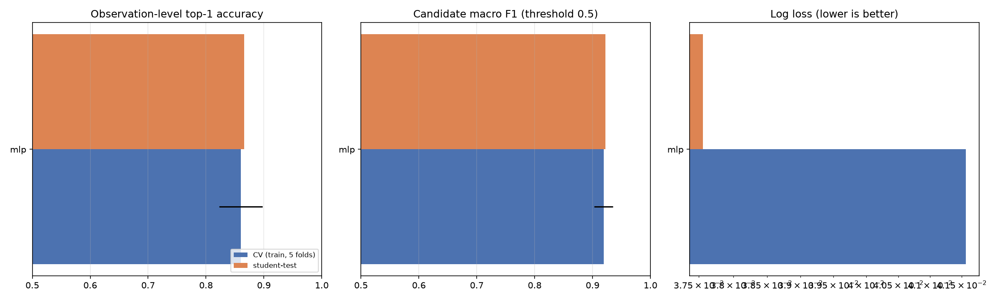
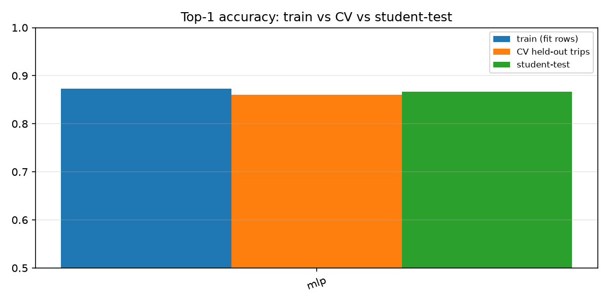
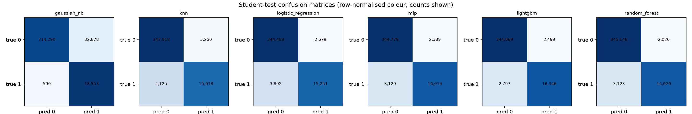
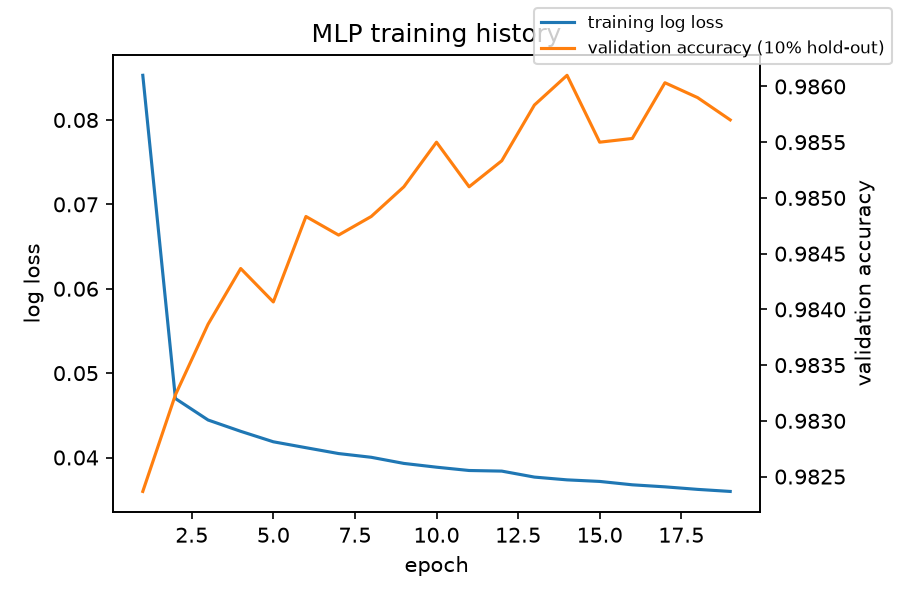

* `results/figures/models_comparison.png`: CV vs student-test top-1, macro F1 and log loss for every model.
* `results/figures/models_train_cv_test.png`: train-fit vs CV vs student-test top-1 (over/underfitting check).
* `results/figures/models_confusion_matrices.png`: student-test candidate-level confusion matrices.
* `results/figures/models_mlp_loss_curve.png`: MLP training loss and validation accuracy per epoch. This is the only model
  with an epoch history; no curves are drawn for the other models.

### 3.4 Model selection

Ranked by the primary metric (CV observation-level top-1; untuned models with a verified CV score): LightGBM 0.860, MLP 0.860, Logistic Regression 0.840, KNN 0.819, Gaussian NB 0.808. (Random Forest: CV score not available, see 3.1; its student-test top-1 of 0.867 is level with the untuned LightGBM's 0.866.)
The best three are within one fold standard deviation (about 0.04) of each other, so CV alone does not separate them. We chose **LightGBM for Bayesian optimisation** because:
1. **It is among the best before tuning** (student-test top-1 0.866, tied with the MLP's 0.866 and the Random Forest's 0.867).
2. **Cost makes tuning feasible.** One LightGBM fit takes about 2.5 s against 249 s for the MLP; thirty trials of group cross-validation cost minutes.
3. **It has the richest search space** (tree count, learning rate, leaves, depth, sampling, L1/L2), so the most to gain from tuning. Logistic regression and naive Bayes underfit, so tuning cannot remove their bias.
4. **Deployment.** The model is small and fast enough for the API.

The choice was confirmed after tuning: the tuned LightGBM is the best model on every quality metric in cross-validation and on student-test (top-1 0.882, macro F1 0.933, log loss 0.032), and also after HMM decoding (0.963, table 3.1).
A better classifier gives a better decoded route, so the classifier choice still matters even with the HMM.

---

## 4. Bayesian Hyperparameter Optimisation (LightGBM)

Code: `src/tuning/bayes_opt.py`. Full trial log: `results/tuning/optuna_trials.csv`; best configuration:
`results/tuning/best_params.json`; comparison: `results/tuning/untuned_vs_tuned.csv`; plots: `results/figures/tuning_history.png`,
`results/figures/tuning_importance.png`. Library: Optuna 5.1, TPE sampler (seed 42, 8 random start-up trials), median pruner.

**1–2. Search space**

| Hyperparameter | Range / distribution | Default (untuned) | Best |
|---|---|---|---|
| n_estimators | int 100–600, step 50 | 100 | 500 |
| learning_rate | log-uniform 0.01–0.3 | 0.1 | 0.0290 |
| num_leaves | log-uniform int 15–255 | 31 | 194 |
| max_depth | categorical {−1 (unlimited), 4, 6, 8, 10, 12} | −1 | 8 |
| min_child_samples | log-uniform int 5–200 | 20 | 13 |
| subsample (bagging fraction, freq 1) | uniform 0.5–1.0 | 1.0 | 0.563 |
| colsample_bytree | uniform 0.4–1.0 | 1.0 | 0.740 |
| reg_alpha (L1) | log-uniform 1e-4–10 | 0 | 0.0832 |
| reg_lambda (L2) | log-uniform 1e-4–10 | 0 | 1.985 |

**3. Objective.** Mean candidate-level **log loss** over a 3-fold GroupKFold (by trip) on the 78 clean train trips, with the same
per-trip training sample (≤ 800 points/trip) and evaluation sample (≤ 1,000 points/trip) as Section 3. We minimised log loss rather than
top-1 for three reasons: the HMM consumes the probabilities, so calibration matters; log loss is smooth (top-1 changes in
steps of single points); and it is a proper scoring rule. Top-1 and macro F1 were logged for every trial as user attributes. A 3-fold search
(instead of 5) kept 30 trials affordable on one laptop; the final comparison below uses the same 5 folds as Section 3 for both models.
Student-test was not used by the objective.

**4. Trials.** 30 trials (27 complete, 3 pruned by the median pruner after their first fold). Trial 0 was the untuned default
configuration, enqueued so the search starts from the baseline (3-fold log loss 0.0464). Best: trial 8, log loss 0.0353.
Many configurations reach 0.0353–0.0354 (trials 8, 18, 22, 24, 28): the optimum is a flat plateau of "more, slower-learning
trees with more leaves, depth ≈ 6–8, row/column subsampling and L2 regularisation".

During development, one point needed care: an early version of the search space forced `max_depth ∈ [3, 14]`. On one fold, fixing
max_depth = 14 alone raised the log loss from 0.0448 to 0.0523, so the default (−1, unlimited) was added as an option. Without it,
the "untuned" starting point would have been worse than the real default.

**5. Best values.** See the table above.

**6. Untuned vs tuned** (same features, same training rows, same 5 CV folds, same student-test set):

| Configuration | CV top-1 | CV macro F1 | CV log loss | Student-test top-1 | Student-test macro F1 | Student-test log loss | Inference (ms / 1k rows) | Fit time (s) |
|---|---|---|---|---|---|---|---|---|
| untuned (LightGBM defaults) | 0.860 | 0.924 | 0.048 | 0.866 | 0.926 | 0.043 | 3.0 | 13.0 |
| tuned (Optuna TPE) | 0.873 | 0.930 | 0.035 | 0.882 | 0.933 | 0.032 | 51.4 | 83.6 |

The tuned model is better on every quality metric. Its CV top-1 (0.873) is above every untuned model with a verified CV score, so after tuning,
LightGBM is the best model overall. The price is inference cost: 500 trees with up to 194 leaves are slower than 100 × 31.
This is still well within the API budget (a whole student-test trip is scored in well under a second; see Section 7 timings).
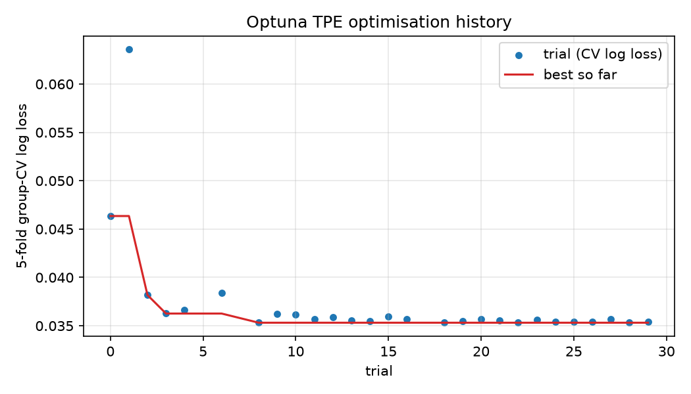
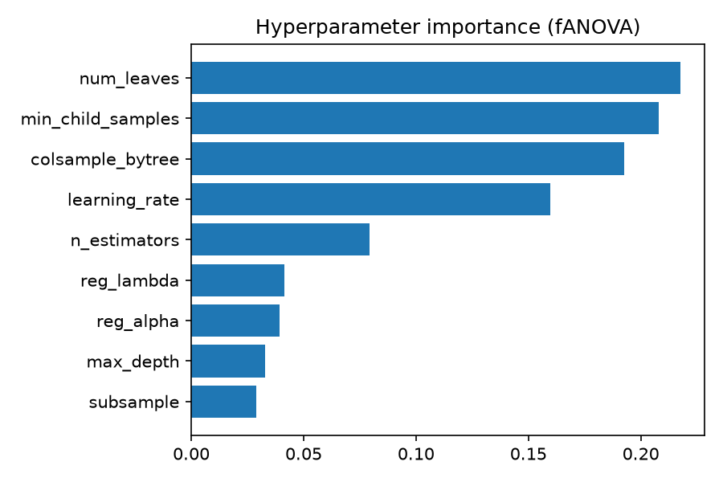

Parameter importance (fANOVA, `tuning_importance.png`): num_leaves 0.22, min_child_samples 0.21, colsample_bytree 0.19, learning_rate 0.16, n_estimators 0.08, reg_lambda 0.04, reg_alpha 0.04, max_depth 0.03, subsample 0.03.

---

## 5. HMM and Viterbi Route Reconstruction

Code: `src/hmm/decoder.py` (model + Viterbi), `src/hmm/evaluate.py` (tuning + comparison), served by `api/pipeline.py`.

### 5.1 Hidden states
At time t the hidden state is **one of the candidate arcs of GPS point t** (≤ 30, the same candidates the classifier scored).
The lattice keeps, for every candidate row, its arc id and its projection fraction along the arc. This is the
candidate-to-arc mapping, so the decoded state index is turned back into an arc id per point.

### 5.2 Emission probabilities
log e_t(a) = w_emis · log max(P_clf(a is the true arc | features), 1e-6), where P_clf is the tuned LightGBM probability
(Section 4). The classifier already uses distance, heading and context, so no separate Gaussian distance term is added.
As an ablation, we also decode with a purely geometric emission exp(−½ (d/10 m)²) (classical Newson & Krumm) to measure
what the classifier contributes.

### 5.3 Transition probabilities
Following Newson & Krumm (2009): a vehicle's network distance between two consecutive fixes should be close to the
straight-line distance between them. For consecutive candidates a (at t−1, fraction f_a) and b (at t, fraction f_b):

* same arc, moving forward: d_route = (f_b − f_a)·L_a
* same arc, moving backward: d_route = back_mult · (f_a − f_b)·L_a (moving backwards on a directed arc is penalised; this is what
  separates an arc from its reverse twin when the vehicle is moving)
* different arcs: d_route = (1 − f_a)·L_a + SP(to(a), from(b)) + f_b·L_b, where SP is the **shortest path on the directed road graph**
  (scipy Dijkstra, bounded to min(3,000 m, 3·max step + 300 m), on the nodes within 800 m of the trajectory)

log T(a→b) = −|d_route − d_gc| / β, where d_gc is the straight-line distance between the two GPS fixes. All pairwise route distances of a
trip are computed once and vectorised (unique (source, target) node pairs, batched Dijkstra), so tuning β, back_mult or
the floor only re-runs the cheap Viterbi pass. The recursion runs in log space with a (K_{t−1} × K_t) max-plus product per step. The Viterbi pass itself costs about
26 ms per 1,000 points on student-test (`decode_s_per_1k_points` in `results/hmm/hmm_vs_classifier_summary.csv`).

### 5.4 Missing candidates and large GPS gaps
* **No candidates** (0.68 % of train points, 0.09 % of student-test): the chain is cut, the point gets no arc (−1, counted as
  wrong in every metric), and Viterbi restarts on the next point that has candidates.
* **Large time gaps** (dt > gap_s; 22 train trips have gaps over 60 s, one up to 153,064 s): the chain is cut and decoding restarts, because
  the road distance across a long gap is not informative. gap_s is a tuned decoder parameter.

### 5.5 Disconnected road segments
89 of 90 trips have several weakly-connected network components, and one-way arcs create many more strongly-connected
components. If no directed path exists within the search bound (or the target lies in another component), the
transition gets a **floor log-probability** (`log_floor`) instead of −∞. The decoder can therefore still "jump" between components
when the emissions at the following points clearly insist on it, rather than getting stuck or failing. Such jumps appear as
breaks in the continuity metric.

### 5.6 Did HMM decoding improve the route?

**Decoder tuning (train only).** Five decoder parameters were tuned with Optuna TPE (30 trials, `results/hmm/decoder_trials.csv`,
`results/figures/hmm_decoder_tuning.png`). The objective was top-1 over all 183,260 clean-train points, decoded from the tuned LightGBM's
**5-fold out-of-fold** probabilities, so the emissions have the same quality as on unseen trips. Student-test was not used.

| Parameter | Search range | Default | Tuned (`configs/hmm.yaml`) |
|---|---|---|---|
| β (transition scale, m) | log 1–100 | 10 | 5.68 |
| w_emis (emission weight) | log 0.2–3 | 1.0 | 0.248 |
| log_floor (no-path transition) | −40 to −5 | −20 | −36.9 |
| back_mult (backward-on-arc cost) | log 1–20 | 4 | 1.11 |
| gap_s (cut the chain above, s) | 10–120 | 60 | 49.6 |

Train OOF top-1: classifier only 0.8532, HMM default 0.9136, HMM tuned **0.9331**. The tuned decoder trusts the road graph more
than the classifier (w_emis 0.25: the emission enters with a quarter of its log weight) and uses a sharper transition (β 5.7 m).
Jumps without a path are almost forbidden (floor −37). The backward penalty became almost neutral (1.11): with a sharp β, moving backwards
along an arc is already expensive, because it makes d_route differ from d_gc.

**Classifier-only vs classifier + HMM on student-test** (`results/hmm/hmm_vs_classifier_summary.csv`, 10 trips, 19,160 points):

| Method | Top-1 | Top-1 (trip mean) | Continuity | Breaks / 1k pts | Edit distance | Route precision | Route recall | Route F1 |
|---|---|---|---|---|---|---|---|---|
| classifier only (tuned LightGBM) | 0.8820 | 0.8931 | 0.9464 | 53.6 | 0.360 | 0.841 | 0.974 | 0.901 |
| classifier + HMM, default decoder | 0.9343 | 0.9390 | 0.9835 | 16.4 | 0.119 | 0.943 | 0.987 | 0.964 |
| **classifier + HMM, tuned decoder** | **0.9627** | **0.9570** | **0.9835** | **16.5** | **0.077** | **0.959** | **0.989** | **0.973** |
| distance-only HMM (no classifier) | 0.9288 | 0.9287 | 0.9817 | 18.3 | 0.121 | 0.923 | 0.981 | 0.950 |

The HMM raises student-test top-1 by **+8.1 points** (0.882 → 0.963), and cuts the normalised edit distance between the collapsed
predicted and reference arc sequences from 0.36 to 0.08. Route precision rises from 0.84 to 0.96: the classifier-only route
contains many spurious arcs (the other direction of the street, side streets at intersections) that the HMM removes. The improvement on
student-test (+8.1 pp) matches the train-OOF improvement (+8.0 pp, 0.853 → 0.933), so the decoder tuning did not overfit the train trips.

*Ablation: does the classifier matter?* A classical HMM with a purely geometric emission (Gaussian in the point-to-arc distance,
σ = 10 m) reaches 0.929. The classifier-driven HMM is 3.4 points better, so heading, kinematic and context features add information the
transition model alone does not have.

*Where the classifier fails and the HMM fixes it* (`results/error_analysis.csv`):

| Share of all student-test points | classifier only | + HMM |
|---|---|---|
| wrong overall | 11.8 % | 3.7 % |
| reverse twin (right street, wrong direction) | 5.2 % | 1.3 % |
| adjacent arc (wrong arc at an intersection) | 1.9 % | 1.5 % |
| other wrong arc | 4.7 % | 1.0 % |
| error rate when speed < 2 m/s | 38.7 % | 12.5 % |
| error rate when moving | 10.6 % | 3.4 % |

The largest single error type of the classifier is the **reverse twin**. When the vehicle is slow, the GPS heading is noise and both
directions look identical point by point. The HMM resolves most of these, because a route cannot flip direction from one second to the next
without a long detour. Points at an intersection improve least: 1.5 % of points are still assigned the arc adjacent to the true one. Our interpretation
(not separately measured) is that near a node the decoder can switch to the next arc a point or two early or late, because the
projection distance is almost the same on both arcs.

**Cases where the HMM did not help (or helped less)**
* **Trip 00000063 (train, OOF)**: the only one of 78 train trips where the HMM is slightly worse (0.8278 → 0.8252). On every student-test
  trip the HMM is better than the classifier (`hmm_vs_classifier_per_trip.csv`).
* **Trips 00000009 and 00000065 (student-test)**: the tuned decoder is *worse than the default decoder* (0.918 → 0.903 and 0.880 →
  0.866), although both beat the classifier. These are the two lowest-scoring test trips. A likely explanation (a hypothesis, not separately tested):
  the tuned decoder's low emission weight makes it stick to a connected path, so where the graph offers two plausible branches
  (parallel roads, many short arcs) it can follow the wrong one for longer before the classifier evidence pulls it back.
  Tuning optimises the average over the train trips, not every individual trip.
* **Remaining continuity "breaks"** (316 on student-test, `results/hmm/break_analysis.csv`): **all 316** are pairs of arcs joined by a
  directed road path of ≤ 300 m. The vehicle crossed one or more short arcs within one GPS interval, which the strict continuity
  metric (same or directly adjacent arc) counts as a break. None is a jump between unconnected parts of the network, so the decoded
  route is fully connected on the road graph.
* **Label-suspect trips 33 and 54**: top-1 only 0.108 → 0.130, because the reference route itself is up to ~130 m away from the GPS (P1's finding).
  The HMM still makes the route more continuous (0.853 → 0.916) and raises route F1 from 0.82 to 0.89. These trips measure
  the quality of the labels, not of the model.

**Cost.** Decoding takes about 26 ms per 1,000 points on student-test, after building the lattice (route distances), which dominates
the decoder time. See Section 7 for the end-to-end API latency.

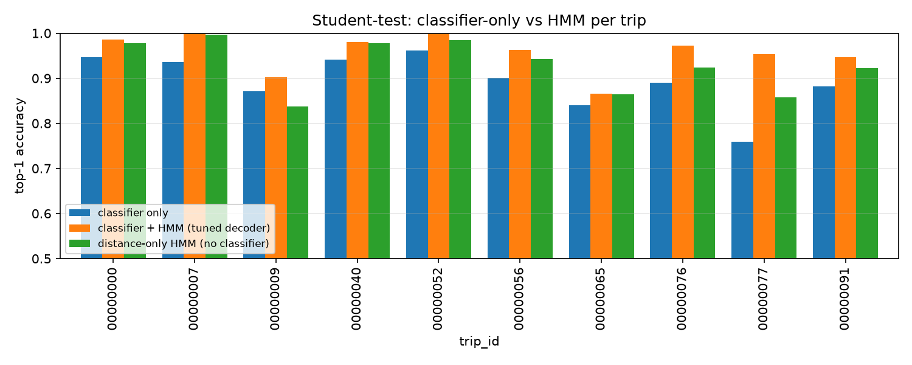
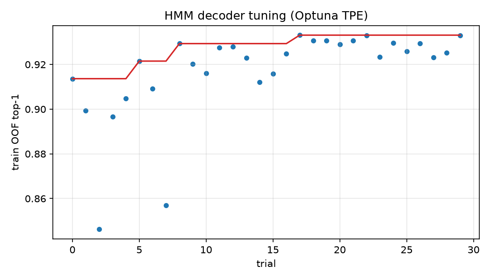

---

## 6. Geographical Visualisation Using Folium

### 6.1 Overview of Folium Visualisation Engine
Geographical visualisation in PathSnap is implemented using **Folium** (v1.0.0) with an underlying Leaflet.js rendering engine. The map component serves as both an interactive analysis tool for exploratory data analysis (EDA) and the primary evaluator-facing visual inspection surface. 

To ensure complete clarity and eliminate visual clutter when displaying road networks containing over 100,000 arcs, our implementation in `src/viz/folium_map.py` dynamically filters the road network within a tunable buffer (default: 150–200 m) of the vehicle trajectory.

### 6.2 Five-Layer Architecture & Legend
The interactive map features five distinct, toggleable layers managed via Leaflet's `LayerControl`:

| Layer Name | Visual Encoding | Style Attributes | Purpose |
|---|---|---|---|
| **1. Road Network** | Thin Grey Polylines (`#94a3b8`) | Weight: 1.5 px, Opacity: 0.6 | Contextual road network topology near the vehicle trajectory. |
| **2. Raw GPS Track** | Cyan/Blue CircleMarkers (`#38bdf8`) with dashed line (`#3b82f6`) | Radius: 3 px, Dash: 4,4 | Raw 1 Hz GPS observations illustrating measurement noise, urban drift, and sensor jumps. |
| **3. Ground Truth Reference** | Emerald Green Thick Line (`#10b981`) | Weight: 5.5 px, Opacity: 0.85 | Actual physical road segments traversed by the vehicle (used for offline comparison). |
| **4. Classifier-Only Route** | Dashed Crimson Line (`#ef4444`) | Weight: 3.0 px, Dash: 6,6 | Top-1 independent argmax predictions prior to sequential decoding. |
| **5. HMM Predicted Route** | Vibrant Orange Thick Line (`#f97316`) | Weight: 4.5 px, Opacity: 0.9 | Final reconstructed route decoded via the Viterbi algorithm. |

A floating, semi-transparent CSS legend (`bottom: 30px; right: 30px`) provides immediate visual reference for all layer colours and symbology.

---

### 6.3 Representative Trip Visualisations & Case Studies

All maps were generated using the reproducible script `python -m src.viz.make_report_maps` and saved as self-contained HTML files in `results/maps/`.

#### Case Study 1: Standard Urban Trajectory — Trip 00000007 (`results/maps/trip_00000007_map.html`)
- **Characteristics:** 1,354 GPS points, duration 1,353 s, urban arterial with multiple turns and intersections.
- **Classifier-Only Accuracy:** 93.65% | Route Continuity: 99.63% (5 breaks).
- **HMM Reconstructed Accuracy:** **99.93%** (+6.28 pp) | Route Continuity: **100.00%** (**0 breaks**).
- **Visual Analysis:** 
  The raw GPS points exhibit moderate lateral scatter (3–10 m) due to urban multipath effects. While the independent classifier occasionally oscillated between opposing parallel arcs at complex intersections, the HMM's route-distance transitions penalise direction flips and disjoint jumps, giving a single fully connected route that matches the reference on 1,353 of 1,354 points.

#### Case Study 2: Long-Distance Complex Highway & Urban Arterial — Trip 00000056 (`results/maps/trip_00000056_map.html`)
- **Characteristics:** 3,958 GPS points, duration 3,957 s, dense urban network transitioning into a multi-lane divided expressway.
- **Classifier-Only Accuracy:** 90.12% | Route Continuity: 91.89% (321 breaks).
- **HMM Reconstructed Accuracy:** **96.34%** (+6.22 pp) | Route Continuity: **96.82%** (126 breaks).
- **Visual & Diagnostic Analysis (Challenging / Failure Case):**
  This trip represents an extreme urban stress case where the vehicle travels along a high-density parallel arterial corridor. Because multiple physical road segments run parallel within 5–8 meters of one another, noisy GPS observations produce high emission probabilities across several adjacent arcs. While the raw classifier produces frequent jumps across parallel lanes, the HMM enforces continuity along the road graph (91.9% → 96.8%). All 126 remaining "breaks" are pairs of arcs joined by a directed road path of at most 300 m, i.e. the vehicle crossed one or more short arcs within one GPS interval (`results/hmm/break_analysis.csv`); none is a jump between unconnected parts of the network.

#### Case Study 3: Short Trajectory with Sensor Gaps — Trip 00000052 (`results/maps/trip_00000052_map.html`)
- **Characteristics:** 262 GPS points, duration 261 s, compact suburban route with sudden speed variations.
- **Classifier-Only Accuracy:** 96.18% | Route Continuity: 95.79% (11 breaks).
- **HMM Reconstructed Accuracy:** **100.00%** (+3.82 pp) | Route Continuity: **96.17%** (10 multi-hop breaks, see `results/hmm/break_analysis.csv`).
- **Visual Analysis:**
  Demonstrates the system's ability to recover rapid manoeuvres and maintain continuous routing even over short trip windows without requiring long warm-up intervals.

#### Screenshots of the interactive maps


The maps of the held-out evaluator trips are in Appendix A.6. Every map is generated from the team's own pipeline (`src/viz/folium_map.py`, `src/viz/make_report_maps.py`, `src/viz/make_final_maps.py`, `src/viz/p1_folium_map.py`).

---

## 7. API, UI and Deployment

### 7.1 Two-laptop architecture
PathSnap runs on two machines over TCP/IP port 8000:

1. **Laptop 1: model host and backend.** FastAPI 0.162.0 under Uvicorn 0.54.0, bound to `0.0.0.0:8000` (`api/main.py`).
   At start-up it loads the tuned LightGBM (`models/lightgbm_tuned.joblib`), the HMM parameters (`configs/hmm.yaml`), the road networks of the evaluation trips, and builds the **private
   server-side reference labels** (monotone-DP alignment of the GPS track to the trip's `.route`, kept in server memory only).
   The prediction function (`api/pipeline.py`, `predict_trip`) loads each trip with `load_route=False`: it reads only `.track`, `.nodes` and `.arcs`.
   The pipeline is: local metric projection per trip, candidate generation (all arcs within 100 m, at most the 30 nearest), 31 features per
   (point, candidate), tuned-LightGBM probabilities, then HMM / Viterbi decoding. The reference labels are used only inside the scoring step of `POST /predict`;
   reference geometry and labels are never returned. Every request is logged (client IP, endpoint, status, latency) to stdout and `logs/api.log`.
2. **Laptop 2: evaluator UI.** A pure client with no model, no data and no labels: either the Streamlit app (`ui/app.py`, Folium map) or the web page served by the API at `/web/` (`ui/index.html`, Leaflet).
   Flow: `GET /health`, `GET /trips`, then the evaluator selects one of the 10 trips; the UI optionally calls `GET /trips/{id}/preview` and `/network`; pressing the run button sends **only the trip ID** in
   `POST /predict {"trip_id": "..."}`; the response contains the predicted (and classifier-only) route polylines, per-point correctness flags, metrics and warnings, which the UI draws.

### 7.2 Endpoints

| Method | Endpoint | Request | Response |
|---|---|---|---|
| GET | `/health` | none | `{"status":"ok","model":"lightgbm_tuned","model_loaded":true,"n_trips":10}` |
| GET | `/trips` | none | `{"trips":[{"trip_id","n_gps_points","duration_s"}, ...]}` (IDs and sizes only) |
| GET | `/trips/{id}/preview` | none | raw GPS track `[lat, lon]`, timestamps, bounding box |
| GET | `/trips/{id}/network` | `?buffer_m=150` | road segments near the trajectory |
| POST | `/predict` | `{"trip_id": "00000015"}` | `pred_route`, `classifier_only_route`, `point_correct`, `metrics`, `warnings` |

Errors are structured JSON: unknown trip -> HTTP 404 `TRIP_NOT_FOUND`; malformed body -> 422 `BAD_REQUEST`; internal failure -> 500 `PIPELINE_ERROR`.
If a trip has no `.route` on the server, `/predict` still returns the route and returns `null` accuracy with a warning (never an invented value).
The response `metrics` are: HMM and classifier-only pointwise accuracy, route continuity (both), macro F1 (both), number of disconnected breaks, inference time (ms).

### 7.3 Screenshots of the working UI

The screenshots were taken from the real evaluator UI (`http://<laptop-1-ip>:8000/web/`, served by the API) running against the 10 evaluator trips. Each result is produced by a live `POST /predict`; nothing is mocked
(`docs/report_sources/capture_ui_screenshots.py` drives the page and takes the screenshots).

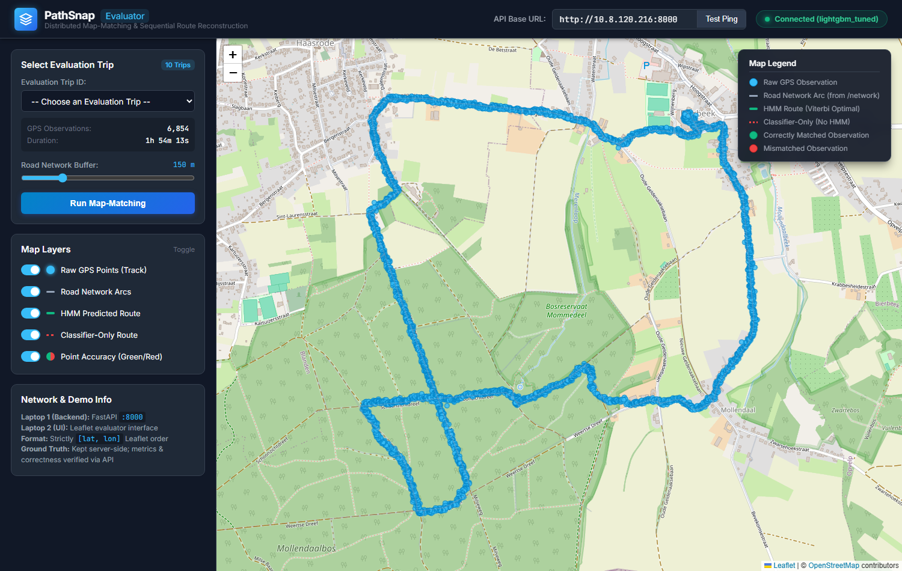

*Figure 7.1. Evaluator UI after connecting to the API at `http://10.8.120.216:8000` (Laptop 1). The badge shows the loaded model; the dropdown lists the 10 evaluation trips.*

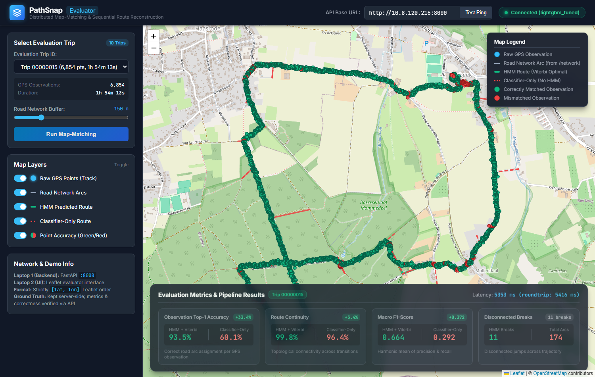

*Figure 7.2. Result for trip 00000015 (6,854 GPS points): observation top-1 93.5 % with HMM against 60.1 % classifier-only, route continuity 99.8 % against 96.4 %, 11 disconnected breaks, latency 5,305 ms.
Green points are correctly matched observations, red points are mismatches (scored server-side; labels are never sent to the UI).*

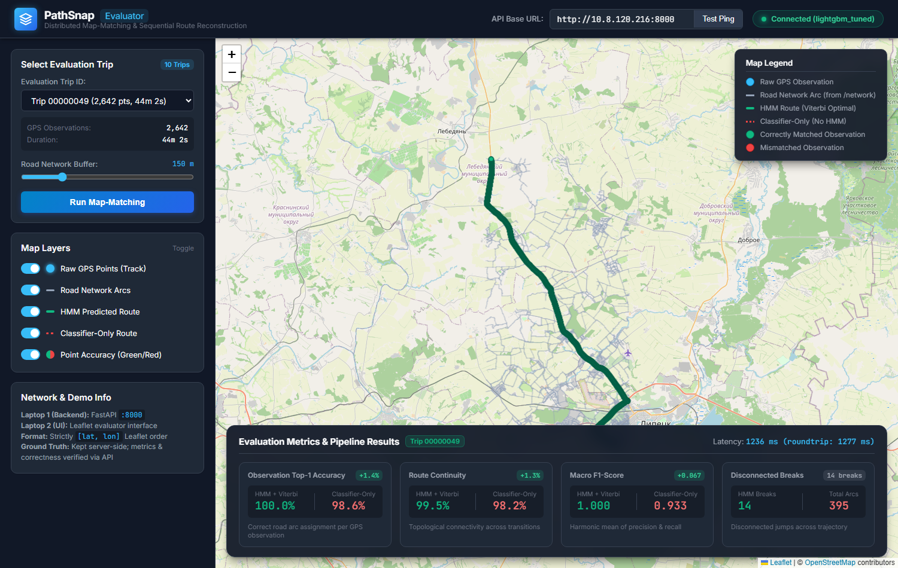

*Figure 7.3. Result for trip 00000049 (2,642 GPS points): 100.0 % with HMM against 98.6 % classifier-only.*

### 7.4 Screenshots of successful API responses and the API request log

Browser views of two API responses (the same endpoints the UI calls):

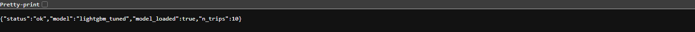

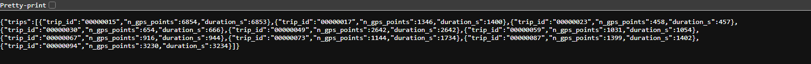

*Figure 7.4. `GET /health` returns the loaded model and trip count; `GET /trips` returns only trip IDs and sizes (no labels).*

API log of the evaluator_test run (client IP, endpoint, status, latency):

```text
2026-11-18 16:26:00 [INFO] [Client: SYSTEM] STARTUP - Successfully loaded model: lightgbm_tuned
2026-11-18 16:26:00 [INFO] [Client: SYSTEM] STARTUP - Discovered 10 evaluation trips in 'evaluator_test' partition
2026-11-18 16:26:03 [INFO] [Client: SYSTEM] STARTUP - PathSnap API Server initialization complete.
2026-11-18 16:26:45 [INFO] [Client: 127.0.0.1] /predict - HTTP 200 [4231 ms]
2026-11-18 16:26:48 [INFO] [Client: 127.0.0.1] /predict - HTTP 200 [2796 ms]
2026-11-18 16:26:49 [INFO] [Client: 127.0.0.1] /predict - HTTP 200 [477 ms]
2026-11-18 16:26:50 [INFO] [Client: 127.0.0.1] /predict - HTTP 200 [1377 ms]
2026-11-18 16:26:51 [INFO] [Client: 127.0.0.1] /predict - HTTP 200 [1238 ms]
2026-11-18 16:26:53 [INFO] [Client: 127.0.0.1] /predict - HTTP 200 [1286 ms]
2026-11-18 16:26:53 [INFO] [Client: 127.0.0.1] /predict - HTTP 200 [578 ms]
2026-11-18 16:26:54 [INFO] [Client: 127.0.0.1] /predict - HTTP 200 [1260 ms]
2026-11-18 16:26:56 [INFO] [Client: 127.0.0.1] /predict - HTTP 200 [1392 ms]
2026-11-18 16:26:58 [INFO] [Client: 127.0.0.1] /predict - HTTP 200 [2346 ms]
```

Cross-machine requests: on 2026-11-18 Laptop 2 (10.8.120.202) reached Laptop 1 (10.8.120.216) over the LAN; the log (`logs/api.log`) records its requests, e.g.
`[Client: 10.8.120.202] /web/ - HTTP 200 [13 ms]`, `/web/app.js - HTTP 200`.

> **To add before submission:** Deliverables section 7 asks for screenshots of the API responses *on the CMD of the receiving laptop*. Take this screenshot of the Laptop 1 terminal during the live two-laptop run
> (the log lines above show what it will contain); it cannot be produced from code and is deliberately not simulated here.

### 7.5 Deployment notes
Python 3.12 is required (`numpy==2.5.5` has no build for 3.11). `uvicorn api.main:app --host 0.0.0.0 --port 8000` on Laptop 1; on Laptop 2 set `UI_API_URL` (Streamlit) or open `http://<laptop-1-ip>:8000/web/`.
Port 8000 must be allowed through the Windows firewall on Laptop 1. The data folder, partition and model can be overridden with the `DATA_DIR`, `EVAL_PARTITION` and `MODEL_PATH` environment variables (used for the evaluator_test run in Appendix A.5).
Full instructions: `docs/HOW_TO_RUN.md` and `docs/DEPLOYMENT_GUIDE.md`.

---

## 8. Academic Integrity, Plagiarism and AI-Use Disclosure

* **Independent work.** The data processing, label derivation, candidate generation, features, models, Bayesian optimisation, HMM decoder, API, UI and maps are the team's own implementation. No model files, weights, code or results
  were shared with other teams.
* **Evaluation integrity.** Models, features, candidate settings and decoder parameters were selected using the 78 clean training trips (cross-validation grouped by trip) and, for reporting only, student_test.
  The evaluator_test partition was read only for the final evaluation in Appendix A, after the pipeline was frozen. Ground-truth routes stay on the server and are never returned by the API. No prediction is hard-coded.
* **Reference labels.** Per-point labels are derived from the supplied reference route and are not independently verified ground truth; train trips 33 and 54 show a reference that is up to about 130 m from the GPS and were excluded from fitting and reported separately.
* **AI assistance (draft for the team to confirm and edit).** An AI coding assistant (Claude Code) was used during the project to explore the dataset, write and run code (data processing, evaluation scripts, parts of the pipeline), run the final evaluation, and draft documentation and this report from the experiment outputs.
  Every number in this report is read from the CSV files in `results/` produced by scripts in the repository. Where a result could not be reproduced from committed files (Random Forest cross-validation figures, note (1) in Section 3.1) this is stated and
  no figure is quoted. Each team member must be able to explain the code, experiments and conclusions; the report text must be read and checked by the team before submission.

---

## Appendix A. Final Held-Out Evaluation (evaluator_test)

**Protocol.** The evaluator_test partition (10 trips, 19,674 GPS points, 337,707 candidate rows) was never read by any
training, feature, tuning or decoder script. The pipeline was **frozen** before this run: tuned LightGBM (`models/lightgbm_tuned.joblib`),
31 features, candidates R = 100 m / K = 30, HMM decoder parameters from `configs/hmm.yaml` (tuned on train out-of-fold predictions only).
Nothing was changed after seeing these results. The evaluation script (`python -m src.eval.final_eval`) was executed three times, only to add
output columns and the candidate-level metrics, and a fourth time through the live API (below); all runs gave identical per-trip scores.
Reference labels come from the same monotone-DP alignment of GPS to `.route` as for train and student_test; their quality is the same
(median GPS-to-reference distance 4.1-5.7 m per trip, maximum 61 m; the reference arc is among the candidates for 100 % of points).
Source: `results/final/*.csv`; code: `src/eval/final_eval.py`.

### A.1 Headline result

| | Top-1 accuracy (point-weighted) | Route continuity | Route F1 |
|---|---|---|---|
| Classifier only | 0.8146 | 0.9510 | 0.881 |
| **Classifier + HMM (final system)** | **0.9576** | **0.9783** | **0.955** |

The final system assigns the correct reference road segment to **95.8 % of the 19,674 GPS observations**
(trip mean 96.0 %, worst trip 85.9 %, best trip 100 %). Decoding raised top-1 by
14.3 percentage points and cut route breaks from 48.9 to
21.7 per 1,000 points.

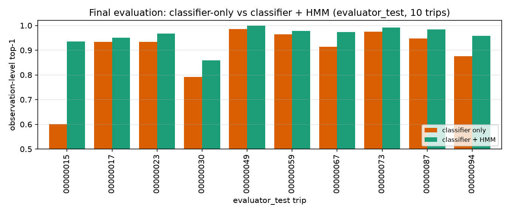

### A.2 Per-trip results (classifier + HMM)

| Trip | GPS points | Top-1 classifier | Top-1 + HMM | Gain (pp) | Continuity + HMM | Breaks + HMM | Route F1 + HMM | API time (ms) |
|---|---|---|---|---|---|---|---|---|
| 00000015 | 6854 | 0.6010 | 0.9349 | +33.4 | 0.9984 | 11 | 0.843 | 9505 |
| 00000017 | 1346 | 0.9331 | 0.9510 | +1.8 | 0.8803 | 161 | 0.949 | 5275 |
| 00000023 | 458 | 0.9345 | 0.9672 | +3.3 | 0.9891 | 5 | 0.948 | 368 |
| 00000030 | 654 | 0.7920 | 0.8593 | +6.7 | 0.9096 | 59 | 0.910 | 1869 |
| 00000049 | 2642 | 0.9856 | 1.0000 | +1.4 | 0.9947 | 14 | 1.000 | 1833 |
| 00000059 | 1031 | 0.9641 | 0.9777 | +1.4 | 0.9301 | 72 | 0.970 | 1332 |
| 00000067 | 916 | 0.9138 | 0.9738 | +6.0 | 0.9913 | 8 | 0.986 | 2783 |
| 00000073 | 1144 | 0.9755 | 0.9913 | +1.6 | 0.9895 | 12 | 0.998 | 1440 |
| 00000087 | 1399 | 0.9478 | 0.9836 | +3.6 | 0.9878 | 17 | 0.976 | 3258 |
| 00000094 | 3230 | 0.8755 | 0.9582 | +8.3 | 0.9793 | 67 | 0.967 | 7217 |

### A.3 Comparison with the development set

| Metric | student_test (development) | evaluator_test (final) |
|---|---|---|
| Classifier-only top-1 (point-weighted) | 0.8820 | 0.8146 |
| Classifier + HMM top-1 (point-weighted) | 0.9627 | 0.9576 |
| Classifier + HMM top-1 (trip mean) | 0.9570 | 0.9597 |
| Route continuity: classifier only / + HMM | 0.9464 / 0.9835 | 0.9510 / 0.9783 |
| Breaks per 1,000 points: classifier only / + HMM | 53.6 / 16.5 | 48.9 / 21.7 |
| Normalised edit distance (trip mean): classifier only / + HMM | 0.360 / 0.077 | 0.316 / 0.107 |
| Route precision / recall / F1 (+ HMM) | 0.958 / 0.989 / 0.973 | 0.930 / 0.984 / 0.955 |
| Candidate-level macro F1 (tuned LightGBM, threshold 0.5) | 0.933 | 0.898 |
| Candidate-level log loss | 0.032 | 0.048 |
| Candidate miss rate | 0.0009 | 0.0000 |

### A.4 Interpretation

* **The final system generalised.** HMM top-1 is 95.8 % on the unseen evaluator set against 96.3 % on student_test,
  a difference of 0.5 percentage points, in the same range as the fold-to-fold spread of the models (about 3.5 pp in cross-validation). The decoder
  parameters were tuned on train only, so there is no tuning on this set to inflate the number.
* **The classifier alone is weaker here, because of one trip.** Classifier-only top-1 is 81.5 % (student_test: 88.2 %).
  Trip 00000015 has 6,854 points (35 % of the set) and the classifier gets only 60.1 % of them right. Without it the classifier-only top-1 is
  92.9 % and the HMM top-1 97.0 % on the other nine trips. For this trip, **32 % of all points are the reverse twin** of the correct street (same geometry,
  opposite direction), 6 % an adjacent arc and 1.6 % another arc; the HMM brings the reverse-twin share down to 3 %, and top-1 from 60.1 % to 93.5 %.
  This is the failure mode identified in Section 5.6 (single-point classification cannot separate a street from its opposite direction), appearing here in extreme form,
  and it is the clearest demonstration of why the HMM stage is needed.
* **The weakest trip is 00000030** (85.9 % with the HMM, 79.2 % without; 654 points, median speed 16 m/s). After decoding, 6.7 % of its points are still the reverse twin,
  3.2 % an adjacent arc and 4.1 % another arc. We did not investigate this trip further, so we do not claim a cause.
* **Candidate-level quality is lower than on student_test** (macro F1 0.898 vs 0.933; log loss 0.048 vs 0.032), consistent with trip 00000015 being a hard trip for
  the classifier. Candidate generation was not a limiting factor: the reference arc was among the candidates for every one of the 19,674 points.
* **Route continuity** is 0.978 (about 22 breaks per 1,000 points). As in Section 5.6, remaining breaks are expected to be pairs of arcs joined by a short directed path (the vehicle crossing short arcs within one GPS interval); we
  did not repeat the break analysis on this set. Trips 00000017, 00000030 and 00000059 have the lowest continuity (0.88, 0.91, 0.93).
* **Limitations.** Reference labels are derived from the reference route, which is not independent ground truth (Section 2); ten trips are a small sample; the per-trip numbers vary from 86 % to 100 %.

### A.5 End-to-end check through the API

All 10 evaluator trips were also run through the deployed pipeline: the API was started with `DATA_DIR`/`EVAL_PARTITION` pointing at the evaluator data and every trip
was sent through `POST /predict`. All 10 requests returned HTTP 200 (1-4 s each; 0.5 s for the 458-point trip, 4.2 s for the 6,854-point trip), the API's server-side top-1 equals the offline
evaluation to the fourth decimal on every trip (maximum difference 0.0), and no response contained reference labels or the reference route.
Evidence: `results/final/evaluator_test_api_check.csv` and the request log lines in Section 7.4.

### A.6 Maps of selected evaluator trips

Interactive maps: `results/maps/evaluator_test_<trip>.html` (code: `src/viz/make_final_maps.py`). Layers: road network, raw GPS, reference route, classifier-only route,
HMM route, per-point correctness.

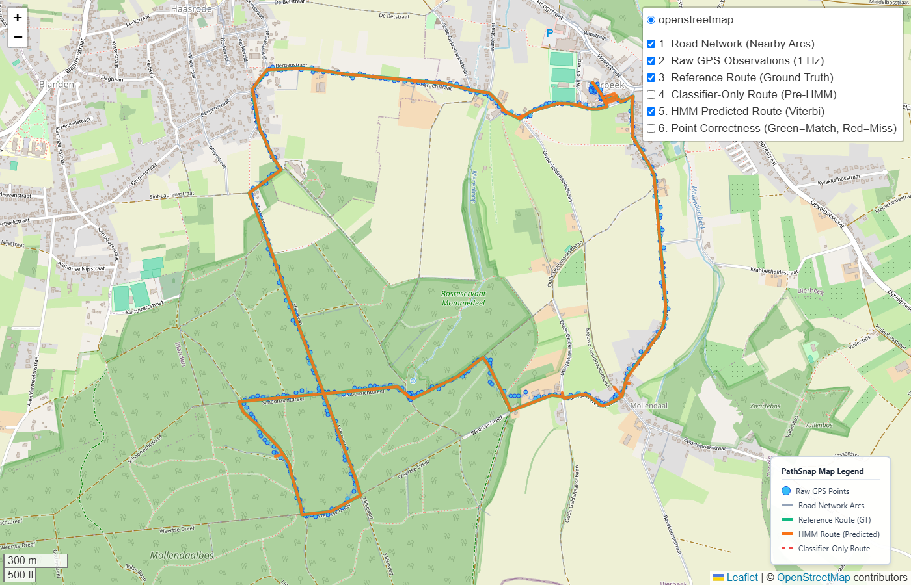
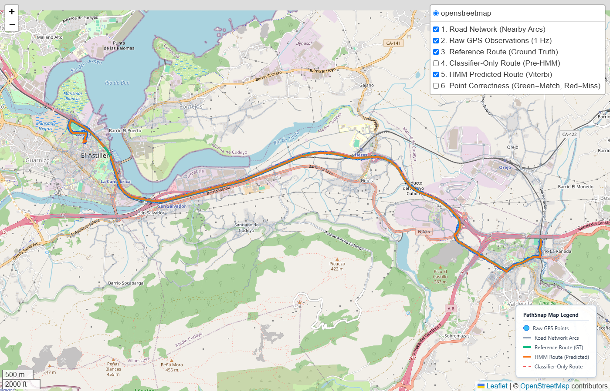
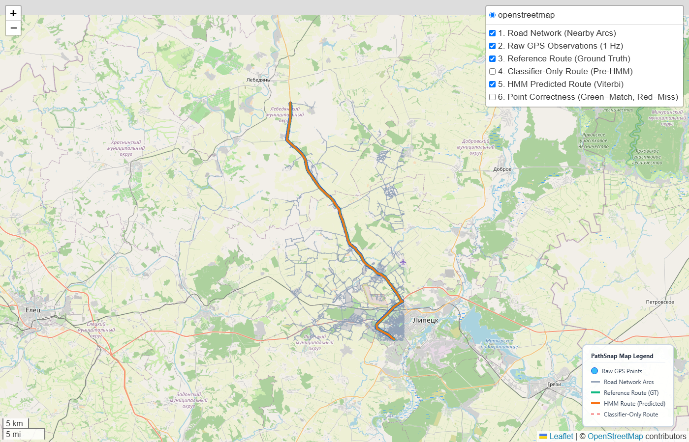
