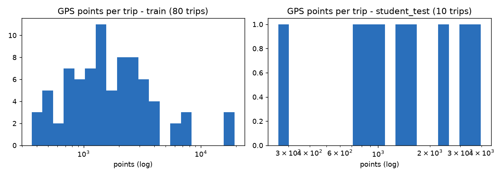
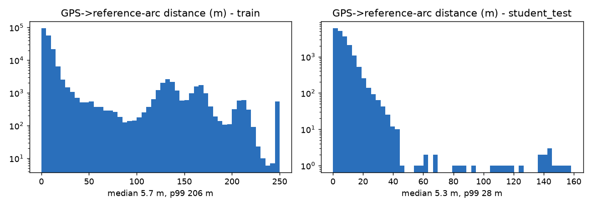
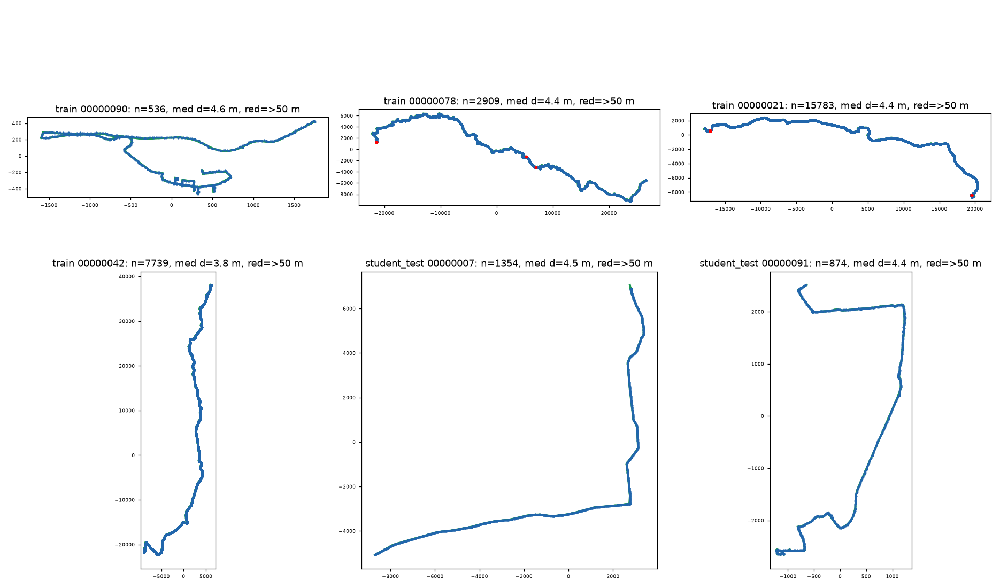
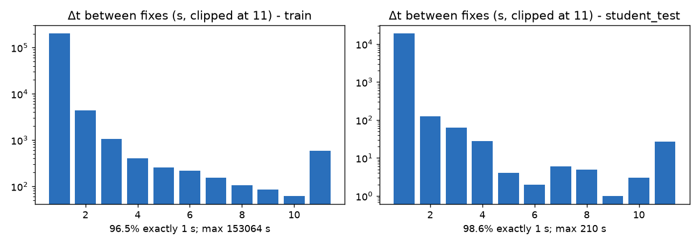
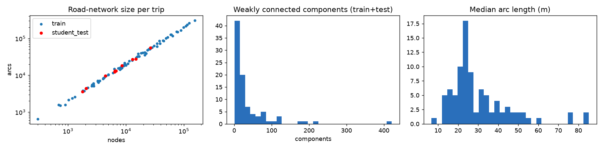
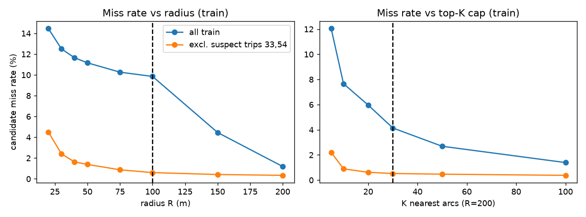
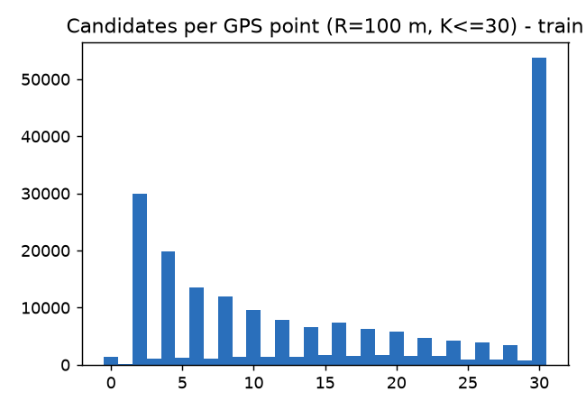

# 2. Dataset Understanding and Exploratory Data Analysis

> Drafted from Person 1's verified findings (`person1/docs/DATA_NOTES.md`) and outputs (`person1/results/eda/`). Person 1 to review.
> Reproduce: `python -m src.data.eda_inventory`, `label_audit`, `radius_sweep`, `build_dataset`, `src.viz.eda_plots`, `src.viz.label_check`
> (run inside `person1/`).

## 2.1 Data and partitions

| | train | student_test | evaluator (hidden) |
|---|---|---|---|
| trips | 80 | 10 | 10 |
| GPS points | 208,417 (361–19,313 per trip) | 19,160 (262–3,958) | not accessed |
| nodes per trip (median) | 9,608 (299–155,003) | 6,596 (1,770–26,635) | |
| arcs per trip (median) | 19,526 | 13,145 | |
| used for | all fitting and every design choice | reporting only | never read |

Each trip has four files: `.track` (lon, lat, t at about 1 Hz), `.nodes` (lon, lat), `.arcs` (directed from/to node ids) and `.route` (the ordered reference arcs).
Every trip has its **own road network**, and the trips are spread **all over the world** (Ecuador, USA, Europe, Asia, ...), one city per trip.

## 2.2 Preprocessing

1. **Projection.** A single UTM zone is wrong for worldwide trips, so each trip is projected into its own **local azimuthal-equidistant CRS (metres),
   centred on its GPS centroid** (`src/data/loader.py`). Distortion is negligible at trip scale (at most about 127 km extent).
2. **Reference labels.** `.route` lists arcs, not per-point labels. Each GPS point gets a reference arc from a **monotone dynamic programme**:
   it minimises the sum of point-to-arc distances, subject to the route index never decreasing (`src/data/labels.py`).
3. **Label audit.** For 88 of 90 trips, the median distance from a GPS point to its reference arc is about 4.6 m (train) / 4.7 m (test), with p99 at 21 / 25 m.
   **Trips 33 and 54 (train)** drift 120–140 m away from the reference route for long stretches (an offset of about 0 m at the start and about 130 m mid-trip).
   54 % / 87 % of their points have no true arc within 100 m. They are flagged `trip_label_suspect`, excluded from training and model selection,
   and reported separately.
4. **Candidate generation.** For each fix, all arcs within **R = 100 m**, capped at the **K = 30** nearest. These values were chosen on train only by a miss-rate sweep.
5. **Scaling.** Any scaler is fit on training folds only (inside each model's Pipeline, Section 3).

## 2.3 Missing values and data quality (all 90 trips, train and student_test)

| Check | Result |
|---|---|
| NaN values, duplicate GPS rows, lon/lat swaps | none |
| timestamps strictly increasing | yes, in all 90 trips |
| GPS fixes inside the network bounding box | all |
| isolated nodes | none |
| sampling interval exactly 1 s | 93.8 % of steps (train) / 98.2 % (test) |
| large time gaps (> 60 s) | 22 train trips (up to 153,064 s in trip 90); 1 test trip (210 s) |
| position jumps > 100 m between fixes | 23 train trips (up to 888 m); 0 test trips |
| road network disconnected (more than one weak component) | 79/80 train, 10/10 test |
| zero-length arcs | 29 train / 3 test trips |
| reference route with breaks (consecutive arcs not sharing a node) | 10 train + 1 test trip (worst 1.9 % of steps) |

There are no missing values in the files. The "missing" information is structural: (a) no per-point labels (derived in 2.2), (b) time gaps,
(c) points without any candidate within 100 m (0.68 % of train points, 0.09 % of student-test), and (d) disconnected network components.
Sections 5.4 and 5.5 describe how the decoder handles (b)–(d).

## 2.4 Patterns observed

* **Arcs are directed, and about 82 % have a reverse twin with identical geometry.** Distance alone cannot tell the two directions of a street apart.
  This led to the signed heading features in Section 3.
* **Dense networks.** About 26 % of train points have more than 30 arcs within 100 m (the K cap binds), so relative features (rank, distance gap) matter.
* **Trip length is very uneven.** Trip 54 alone holds 9 % of the train points, which motivated group-aware CV by trip and a per-trip cap on training rows.
* **Disconnected networks and long gaps** are common, so the HMM must cut and restart at gaps and allow jumps between network components.

## 2.5 Candidate radius and cap (train only)

| | train (all) | train (excl. 33, 54) | student_test |
|---|---|---|---|
| candidate miss rate (true arc not among candidates) | 10.2 % | **0.65 %** | **0.09 %** |
| candidates per point | 15.6 | – | 19.1 |

R = 50 m doubles the miss rate (1.4 %); R = 150 m lowers it by only 0.2 pp, for about twice as many candidates.

## 2.6 Features extracted and why

The 31 features (geometry, relative-to-other-candidates, signed heading, kinematics, topology and neighbour/graph context) follow
directly from the patterns above. They are listed with their motivation in the feature table at the start of Section 3.

## 2.7 Geographical map (Folium)

Interactive maps: `person1/results/maps/eda_train_00000001.html` (GPS fixes, nearby network, reference route, the candidates of one point) and
`person1/results/maps/eda_train_00000033_drift.html` (the GPS drift of a label-suspect trip). The prediction maps are in Section 6.
**Person 1 to insert a screenshot of `eda_train_00000001.html` here.**
